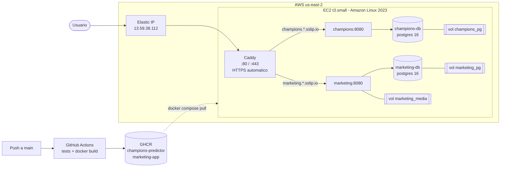

# Despliegue

## URLs

| App | URL |
|---|---|
| Pregunta 1 - Champions Predictor | https://champions.13-59-38-112.sslip.io |
| Pregunta 2 - Postea | https://marketing.13-59-38-112.sslip.io |

## Arquitectura del despliegue



- **Imagenes**: cada push a `main` corre los tests y publica `ghcr.io/kaloslazo/champions-predictor` y
  `ghcr.io/kaloslazo/marketing-app` con tag `latest` y el SHA del commit.
- **Servidor**: una EC2 t3.small (2 vCPU, 2 GB RAM + 2 GB de swap) con Docker y Docker Compose.
- **Dominio y HTTPS**: se usa [sslip.io](https://sslip.io), que resuelve `<algo>.13-59-38-112.sslip.io` a la IP,
  y Caddy saca los certificados de Let's Encrypt solo. HTTPS hace falta en la pregunta 2 porque Instagram
  descarga las fotos y el video desde la URL publica de la app.
- **Persistencia**: las bases de datos y los archivos generados estan en volumenes de Docker, asi que
  sobreviven a reinicios y a actualizaciones de las imagenes.

## Variables de entorno en el servidor

Archivo `/opt/lab5/.env` (no esta en el repo):

```
CHAMPIONS_HOST=champions.13-59-38-112.sslip.io
MARKETING_HOST=marketing.13-59-38-112.sslip.io
CHAMPIONS_DB_PASSWORD=<generada con openssl rand -hex 16>
MARKETING_DB_PASSWORD=<generada con openssl rand -hex 16>
FOOTBALL_DATA_TOKEN=
ANTHROPIC_API_KEY=
INSTAGRAM_USER_ID=
INSTAGRAM_TOKEN=
```

## Procedimiento

### 1. Publicar las imagenes

El workflow [`images.yml`](../.github/workflows/images.yml) se ejecuta en cada push a `main`
(o a mano desde la pestaña Actions). Tambien se puede hacer manualmente:

```bash
echo $GITHUB_TOKEN | docker login ghcr.io -u kaloslazo --password-stdin
docker build -t ghcr.io/kaloslazo/champions-predictor:latest champions
docker build -t ghcr.io/kaloslazo/marketing-app:latest marketing
docker push ghcr.io/kaloslazo/champions-predictor:latest
docker push ghcr.io/kaloslazo/marketing-app:latest
```

### 2. Crear la infraestructura en AWS (CLI)

```bash
export AWS_REGION=us-east-2

# llave ssh
aws ec2 create-key-pair --key-name lab5-key --key-type ed25519 \
  --query KeyMaterial --output text > ~/.ssh/lab5-key.pem
chmod 600 ~/.ssh/lab5-key.pem

# security group: ssh solo desde mi ip, http/https abierto
VPC=$(aws ec2 describe-vpcs --filters Name=is-default,Values=true --query 'Vpcs[0].VpcId' --output text)
SG=$(aws ec2 create-security-group --group-name lab5-sg --description "lab5 despliegue" \
  --vpc-id $VPC --query GroupId --output text)
MYIP=$(curl -s https://checkip.amazonaws.com)
aws ec2 authorize-security-group-ingress --group-id $SG --ip-permissions \
  "IpProtocol=tcp,FromPort=22,ToPort=22,IpRanges=[{CidrIp=$MYIP/32}]" \
  "IpProtocol=tcp,FromPort=80,ToPort=80,IpRanges=[{CidrIp=0.0.0.0/0}]" \
  "IpProtocol=tcp,FromPort=443,ToPort=443,IpRanges=[{CidrIp=0.0.0.0/0}]"

# instancia (user-data instala docker, compose y swap)
AMI=$(aws ssm get-parameter --name /aws/service/ami-amazon-linux-latest/al2023-ami-kernel-default-x86_64 \
  --query Parameter.Value --output text)
IID=$(aws ec2 run-instances --image-id $AMI --instance-type t3.small --key-name lab5-key \
  --security-group-ids $SG \
  --block-device-mappings 'DeviceName=/dev/xvda,Ebs={VolumeSize=20,VolumeType=gp3}' \
  --user-data file://deploy/user-data.sh \
  --tag-specifications 'ResourceType=instance,Tags=[{Key=Name,Value=lab5-despliegue}]' \
  --query 'Instances[0].InstanceId' --output text)
aws ec2 wait instance-running --instance-ids $IID

# ip fija
ALLOC=$(aws ec2 allocate-address --domain vpc --query AllocationId --output text)
aws ec2 associate-address --instance-id $IID --allocation-id $ALLOC
```

### 3. Levantar las apps en el servidor

```bash
scp -i ~/.ssh/lab5-key.pem deploy/docker-compose.yml deploy/Caddyfile ec2-user@13.59.38.112:/opt/lab5/
ssh -i ~/.ssh/lab5-key.pem ec2-user@13.59.38.112

cd /opt/lab5
nano .env            # variables de arriba
docker compose pull
docker compose up -d
docker compose ps
```

### 4. Actualizar a una version nueva

```bash
cd /opt/lab5
docker compose pull && docker compose up -d
```

Para volver a una version anterior: `TAG=<sha del commit> docker compose up -d`.

### 5. Activar las integraciones reales

Editar `/opt/lab5/.env` y reiniciar con `docker compose up -d`:

- `FOOTBALL_DATA_TOKEN`: partidos reales (al reiniciar `champions` se vuelven a cargar).
- `ANTHROPIC_API_KEY`: guiones generados por Claude a partir de la foto.
- `INSTAGRAM_USER_ID` + `INSTAGRAM_TOKEN`: publicacion real (cuenta business o creator vinculada a una pagina de Facebook,
  token con `instagram_basic` e `instagram_content_publish`).

## Comandos utiles

```bash
docker compose logs -f champions
docker compose logs -f marketing
docker compose exec champions-db psql -U champions -d champions -c "select count(*) from matches;"
docker compose exec marketing-db psql -U marketing -d marketing -c "select id, business_name, status from campaigns;"
```

## Costo aproximado

t3.small en us-east-2: ~0.021 USD/h (~15 USD/mes) + 20 GB gp3 (~1.6 USD/mes) + IP publica (~3.6 USD/mes).
Para no pagar cuando no se usa: `aws ec2 stop-instances --instance-ids <id>` (la Elastic IP se mantiene).

## Evidencias

> Agregar capturas en `docs/evidencias/`:
> - Pestaña Actions con el workflow en verde
> - Paquetes en GHCR
> - Instancia EC2 corriendo en la consola de AWS
> - `docker compose ps` en el servidor
> - Las dos apps funcionando por HTTPS (listado, prediccion, campaña con guiones, fotos, video y publicacion)
