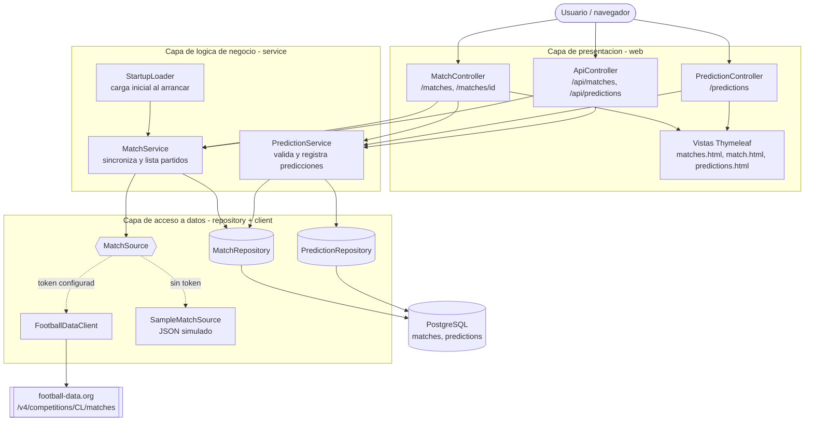
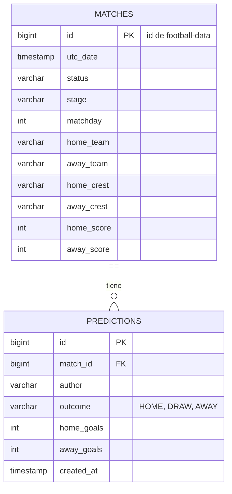
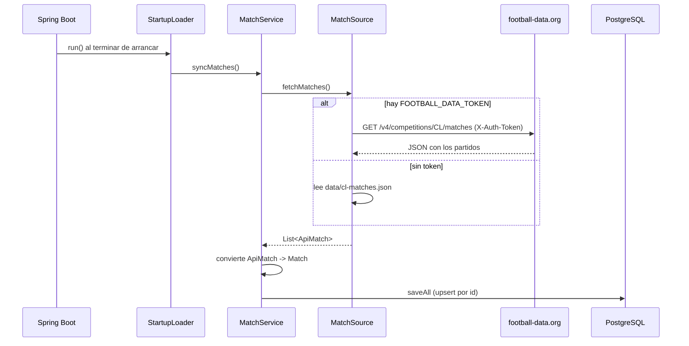
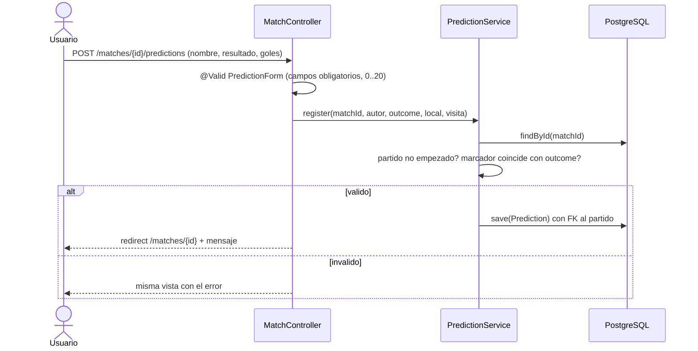

# Pregunta 1 - Champions Predictor

Aplicacion web para ver los partidos de la Champions League y registrar predicciones.
Hecha en Java 21 con Spring Boot 4, Thymeleaf y PostgreSQL.

## Arquitectura en 3 capas

| Capa | Paquete | Responsabilidad |
|---|---|---|
| Presentacion | `pe.edu.utec.champions.web` | Controladores MVC, formularios, validacion de campos, vistas y endpoints JSON |
| Negocio | `pe.edu.utec.champions.service` | Reglas: no predecir partidos ya empezados, marcador coherente con el resultado, calculo de aciertos |
| Datos | `pe.edu.utec.champions.repository`, `client`, `model` | Entidades JPA, repositorios Spring Data, cliente HTTP de la API externa |

Cada capa solo conoce a la de abajo. Los controladores nunca tocan los repositorios directamente
y los servicios no saben nada de HTTP ni de las vistas.

## Modelo de datos

## Flujo de datos

### 1. Carga inicial (requerimientos 1 y 2)

Se usa el `id` que trae la API como llave primaria, asi al reiniciar la app los partidos se actualizan
(marcadores, estado) en vez de duplicarse. Si la API falla, la app arranca igual con lo que ya tenia la base de datos.

### 2. Listado de partidos (requerimiento 3)

`GET /matches?stage=...` -> `MatchController.list` -> `MatchService.list(stage)` -> `MatchRepository.findAllByOrderByUtcDateAsc()` -> vista `matches.html`.

### 3. Registrar prediccion (requerimientos 4 y 5)

### 4. Consultar predicciones (requerimiento 6)

`GET /predictions` muestra todas las predicciones con su partido. Cuando el partido termina
se calcula si acerto el resultado o el marcador exacto. Lo mismo en JSON en `GET /api/predictions`.

## Endpoints

| Metodo | Ruta | Descripcion |
|---|---|---|
| GET | `/matches` | Listado de partidos, filtro opcional `?stage=` |
| GET | `/matches/{id}` | Detalle, formulario y predicciones del partido |
| POST | `/matches/{id}/predictions` | Registra una prediccion |
| GET | `/predictions` | Todas las predicciones |
| GET | `/api/matches` | Partidos en JSON |
| GET | `/api/predictions` | Predicciones en JSON |
