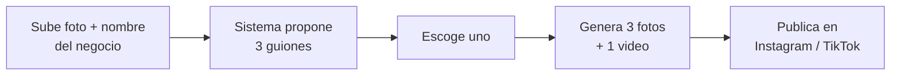
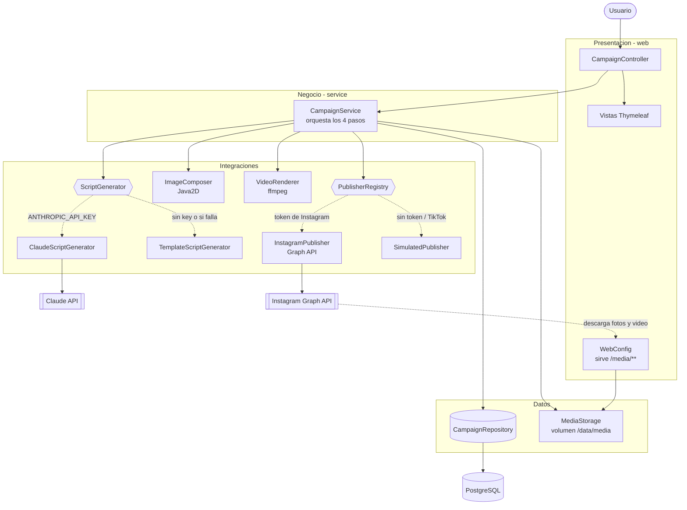
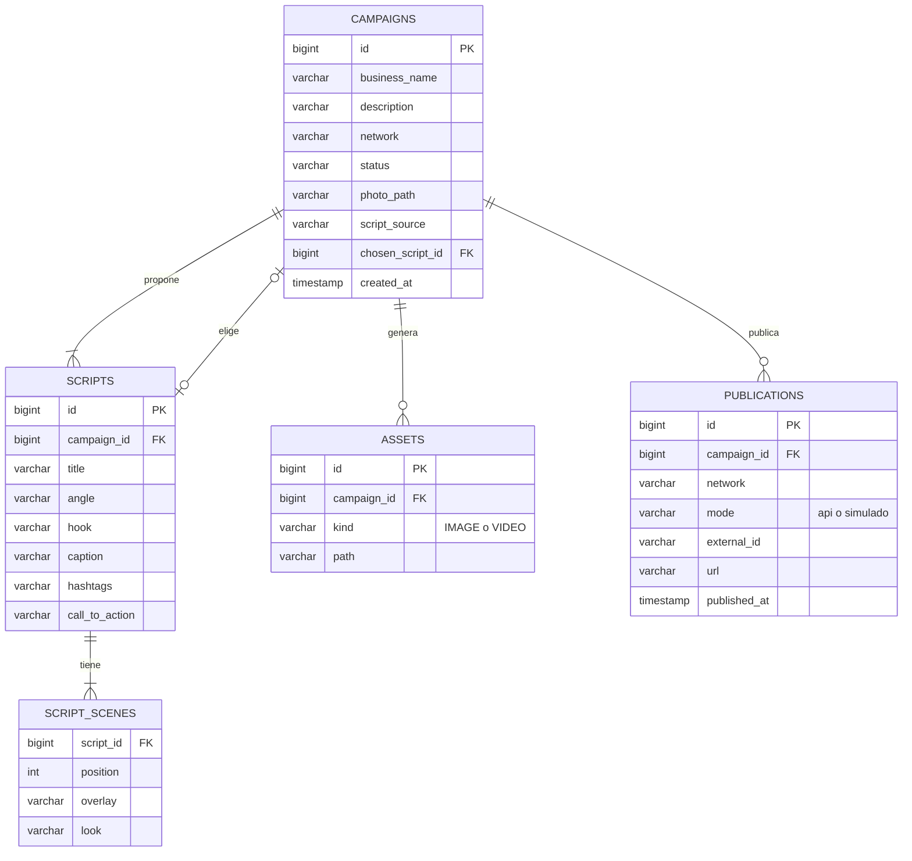

# Pregunta 2 - Postea (marketing para empresas)

Aplicacion web donde un negocio sube una foto, el sistema le propone 3 guiones, escoge uno
y se generan 3 fotos y un video vertical que se publican en Instagram o TikTok.

Java 21, Spring Boot 4, Thymeleaf, PostgreSQL, SDK oficial de Anthropic (Claude) y ffmpeg.

## Flujo del usuario

Cada campaña guarda su estado: `SCRIPTS_READY -> SCRIPT_CHOSEN -> MEDIA_READY -> PUBLISHED`.
El servicio no deja saltarse pasos (no se puede publicar sin generar, ni cambiar el guion despues de publicar).

## Arquitectura

### Como funciona cada paso

**1. Recibe la foto.** Se valida que sea JPG o PNG (max 10 MB), se reduce a 2048 px de lado mayor y se guarda
como `original.jpg` en una carpeta propia de la campaña.

**2. Propone 3 guiones.** `ClaudeScriptGenerator` manda la foto (reducida a 1568 px) y los datos del negocio al modelo
de Claude, pidiendo la respuesta con *structured outputs* (`ScriptDrafts`), asi siempre llega un JSON valido con:
titulo, enfoque, gancho, 3 escenas (texto + filtro), caption, hashtags y llamado a la accion.
`Drafts.toScript` normaliza la respuesta (siempre 3 escenas, hashtags limpios, textos recortados).
Si no hay API key o la llamada falla, `TemplateScriptGenerator` arma 3 guiones con plantillas para que el flujo no se caiga.

**3. Escoge uno.** Se guarda la referencia al guion elegido.

**4a. Genera 3 fotos y un video.**
- `ImageComposer` arma cada foto a partir de la original: un recorte/zoom distinto por escena, el filtro de color
  de la escena (`WARM`, `COOL`, `VIVID`, `MONO`), un degradado inferior, el texto de la escena y el nombre del negocio.
  Las fotos salen en 1080x1350 (formato 4:5 del feed).
- Para el video se generan 3 cuadros verticales 720x1280 con margenes mas grandes y `VideoRenderer` llama a ffmpeg:
  cada cuadro dura 3 s con zoom lento (`zoompan`) y fundido entre escenas (`xfade`). Sale un MP4 H.264 de 8 s.

**4b. Publica.** `PublisherRegistry` elige el publicador segun la red:
- Instagram con credenciales: carrusel con las 3 fotos + reel con el video, usando la Graph API.
  Instagram descarga los archivos desde `PUBLIC_BASE_URL/media/...`, por eso la app tiene que estar publicada con HTTPS.
- Sin credenciales, o TikTok (su API de publicacion exige una app auditada): modo simulado, se registra la
  publicacion y se genera una vista previa del post en `/campaigns/{id}/preview`.

## Modelo de datos

Los archivos (foto original, fotos generadas, cuadros y video) van en disco, en un volumen de Docker.
En la base de datos solo se guarda la ruta relativa.

## Variables de entorno

| Variable | Para que |
|---|---|
| `DB_URL`, `DB_USER`, `DB_PASSWORD` | Conexion a PostgreSQL (sin `DB_URL` usa H2 en archivo) |
| `MEDIA_DIR` | Carpeta de archivos generados (`/data/media` en Docker) |
| `PUBLIC_BASE_URL` | URL publica de la app, la usa Instagram para descargar los archivos |
| `ANTHROPIC_API_KEY` | Activa la generacion de guiones con Claude |
| `ANTHROPIC_MODEL` | Modelo a usar (por defecto `claude-opus-5-5`) |
| `INSTAGRAM_USER_ID`, `INSTAGRAM_TOKEN` | Publicacion real en Instagram (cuenta business o creator) |
